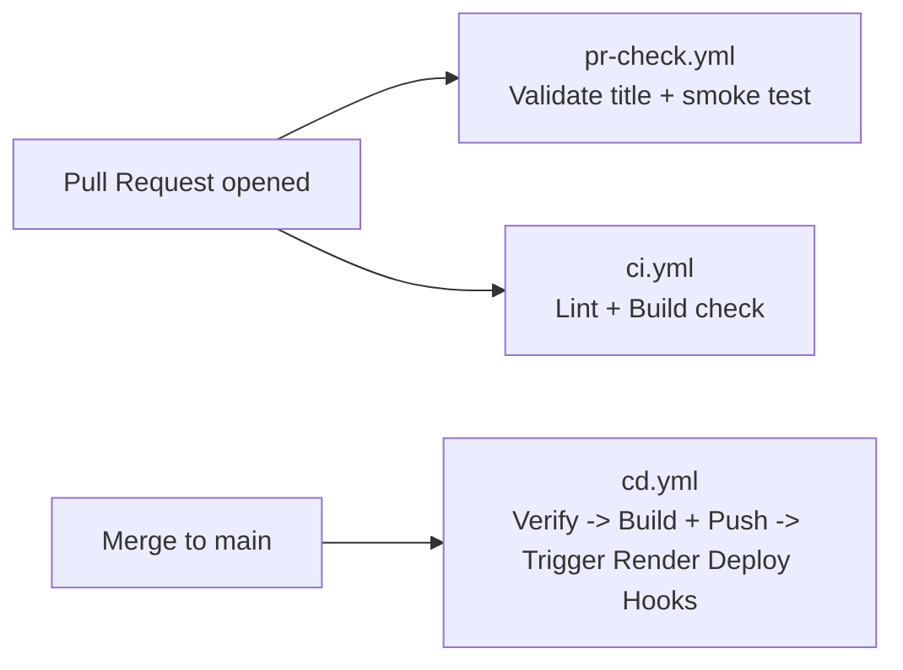

# GitHub Actions CI/CD — Dataset Analyser (Render.com)

Three workflow files were created under `.github/workflows/`.

---

## Pipeline Overview

---

## Workflows

### 1. `ci.yml` — Continuous Integration
**Triggers:** Every push to `main` / `develop`, every PR.

| Job | What it does |
|-----|-------------|
| **Frontend** | `npm ci` → `npm run lint` → `npm run build` |
| **Backend** | `pip install` → `ruff check backend/` |
| **Docker** | Builds both images in GitHub to ensure standard configurations are healthy |

---

### 2. `cd.yml` — Continuous Deployment (Render)
**Triggers:** Every push to `main`, or manually via `workflow_dispatch`.

| Job | What it does |
|-----|-------------|
| **verify** | Runs the same lint and build checks as `ci.yml`. Both build jobs depend on it, so a failing check stops the deployment before any image is pushed. |
| **build-push-frontend** / **build-push-backend** | Builds each image and pushes it to Docker Hub, tagged with the commit SHA and `latest`. |
| **summary** | Writes the pushed image tags to the job summary. |
| **deploy-to-render** | Pings the **Render Deploy Hooks** using `curl` to tell Render to fetch the new code and build/deploy it. This guarantees Render only deploys code that has already passed the GitHub Actions checks! |

---

### 3. `pr-check.yml` — PR Quality Gate
**Triggers:** Every PR opened / updated against `main` or `develop`.

| Job | What it does |
|-----|-------------|
| **validate-title** | Enforces [Conventional Commits](https://www.conventionalcommits.org/) format (`feat:`, `fix:`, `docs:`, etc.) |
| **smoke-test** | Installs both frontend and backend deps, then verifies `backend/main.py` imports cleanly |

---

## ⚙️ How to Setup with Render

Since Render handles its own container building and hosting, we just need to use **Deploy Hooks** to tell it when it's safe to update!

### Step 1 — Turn OFF Auto-Deploy in Render
By default, Render auto-deploys immediately when you push code to GitHub. But we want it to wait for our GitHub Actions CI tests to pass first!
1. Go to your Render Dashboard.
2. Open your Backend service → **Settings** → **Auto-Deploy**. Change it to `No`.
3. Open your Frontend service → **Settings** → **Auto-Deploy**. Change it to `No`.

### Step 2 — Copy your Deploy Hooks
1. In your Render Backend service → **Settings** → **Deploy Hook**. Copy the URL.
2. In your Render Frontend service → **Settings** → **Deploy Hook**. Copy the URL.

### Step 3 — Add Secrets to GitHub
Go to **GitHub → Your Repo → Settings → Secrets and variables → Actions → New repository secret**.

Add these secrets exactly:

| Secret Name | Value |
|---|---|
| `DOCKER_HUB_USERNAME` | Your Docker Hub username (e.g. `uditsingh1893`) |
| `DOCKER_HUB_TOKEN` | A Personal Access Token from Docker Hub |
| `NEXT_PUBLIC_BACKEND_URL` | The production URL of your backend (e.g. `https://dataset-analyser.onrender.com`) |
| `RENDER_DEPLOY_HOOK_BACKEND` | The Backend Deploy Hook URL you copied (e.g. `https://api.render.com/deploy/srv-...`) |
| `RENDER_DEPLOY_HOOK_FRONTEND` | The Frontend Deploy Hook URL you copied (e.g. `https://api.render.com/deploy/srv-...`) |

### Step 4 — Verify
Push a new commit to `main`.
1. GitHub Actions will start the `CD — Build & Push Docker Images` workflow.
2. Its `verify` job runs the lint and build checks. If they fail, nothing is pushed and Render is never notified.
3. Once they pass, both images are pushed to Docker Hub and the CD workflow hits your Webhooks — you will see your services spinning up in the Render Dashboard!