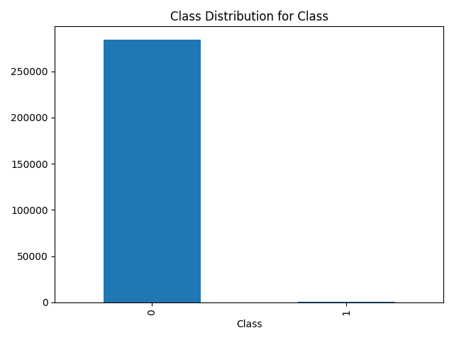
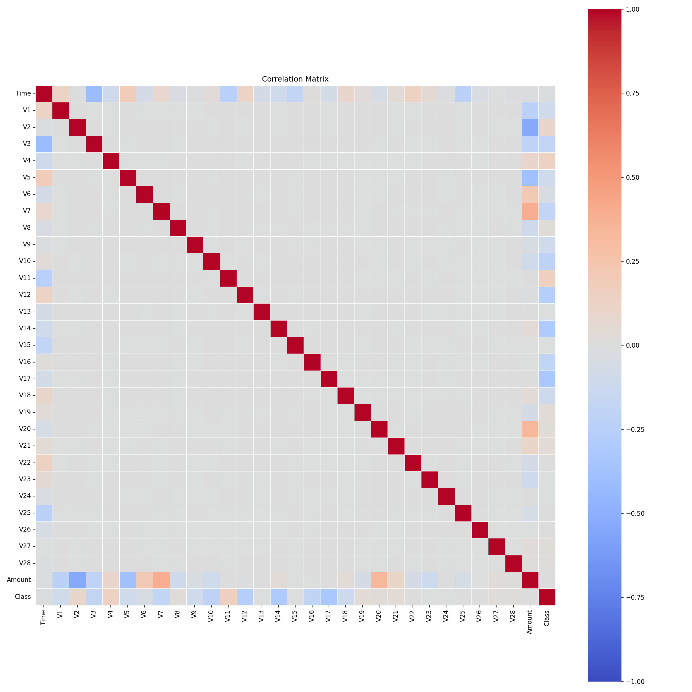
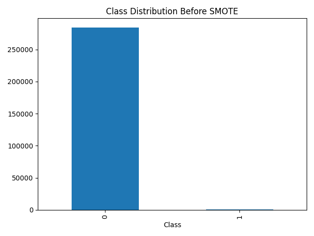
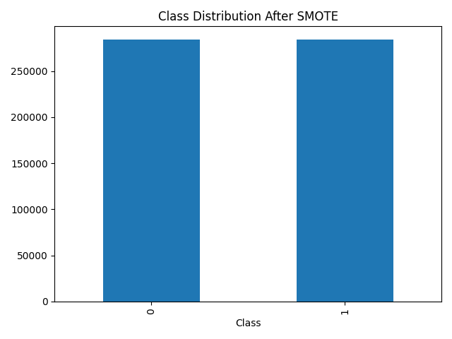

# CSV Bias & SMOTE Analysis Platform

A full-stack web application that:
- Accepts CSV datasets
- Automatically detects target variables
- Summarises class and subgroup distributions
- Applies SMOTE for class imbalance
- Generates inverse-frequency weighted datasets
- Returns downloadable output files

> **On "bias analysis":** the app reports *descriptive* statistics — how class
> labels are distributed across detected subgroups. It does not compute
> fairness metrics (equalized odds, demographic parity, or a fairness score),
> and it does not make judgements about whether a dataset is fair. The
> subgroup breakdowns are the raw counts a fairness metric would be built on.

---

## Live Demo

- **Web App:**  
   https://dataset-bias-analyser.onrender.com

- **Sample Dataset:**
   [dataset.csv](public/dataset.csv) (the synthetic `age/income/gender/race` demo set)

- **Sample Output** (from the CreditCard fraud dataset, 284,807 rows):

   [bias_report.txt](public/bias_report.txt)

   
   
   
   

> **Note on the large sample output:** the balanced CreditCard dataset is
> 568,630 rows, which is ~304 MB as a plain CSV. That exceeds GitHub's 100 MB
> per-file push limit, so `smote_resampled.csv` is gitignored and is not
> committed. The charts and `bias_report.txt` above were generated from that
> run. To regenerate the CSV, run the backend on
> `backend/uploads/CreditCard.csv` and download it from the results list.
---

## Tech Stack
- **Frontend:** Next.js (App Router) + Tailwind CSS
- **Backend:** FastAPI + Pandas
- **ML:** Scikit-learn, Imbalanced-learn (SMOTE)
- **Infrastructure:** Docker, Docker Compose
- **Hosting:** Render
- **Architecture:** Monorepo (frontend + backend)

---

## Features
- CSV upload via web UI
- Automatic target variable detection, with an optional manual override
- Class distribution, correlation matrix and subgroup breakdowns
- SMOTE-based class balancing (categorical columns preserved)
- Inverse-frequency sample weighting for detected sensitive attributes
- Downloadable processed output files
- Stateless backend with per-upload isolation

---

## SMOTE Pipeline

The uploaded dataset is treated as the **training set** and is balanced in
place. It is never split, so there is no train/test leakage to guard against:
every row in the output is either an original row or a synthetic one, and all
of them come from the same source distribution.

1. **Detect** the target column (auto-detected, or supplied by the user).
2. **Impute** missing values in continuous features with the column median,
   since SMOTE's nearest-neighbour search cannot handle NaNs.
3. **Scale** the continuous features with `StandardScaler`, so no single
   feature dominates the distance calculation SMOTE relies on.
4. **Oversample** the minority class up to the majority class, using
   `SMOTENC` when the dataset has categorical features and plain `SMOTE`
   when it is entirely numeric.
5. **Invert the scaling** and restore the original column order and dtypes, so
   the output matches the uploaded dataset's layout and units.

Output files:

| File | Contents |
|------|----------|
| `smote_resampled.csv` | The full dataset, class-balanced, with all original columns and rows preserved |
| `bias_report.txt` | Dataset shape, target column, class distribution and per-subgroup breakdowns |
| `class_distribution.png` | Bar chart of the class counts before balancing |
| `correlation_matrix.png` | Correlation heatmap of the numeric columns |
| `sensitive_<col>_bias.png` | Class counts per detected sensitive attribute |
| `smote_before.png` / `smote_after.png` | Class counts before and after SMOTE |
| `weighted_<col>.csv` | The dataset with an added inverse-frequency `sample_weight` column per sensitive attribute |

Categorical columns (`gender`, `race`, ...) are kept and carried through to the
output rather than being dropped. If the smallest class has fewer than 6
samples, SMOTE cannot run and the dataset is returned unbalanced with a
warning.

### Worked example: CreditCard fraud dataset

Running the backend on `backend/uploads/CreditCard.csv` (284,807 rows, 30
numeric features, target `Class`):

| | Class 0 | Class 1 | Total rows |
|---|---|---|---|
| Before | 284,315 | 492 | 284,807 |
| After  | 284,315 | 284,315 | 568,630 |

All 284,807 original rows are retained and 283,823 synthetic rows are added.
Because the dataset is entirely numeric, plain `SMOTE` is used. The run takes
about 48 seconds end to end, and the resulting CSV is ~318 MB.

The `bias_report.txt` and the four charts in `public/` come from this run.

---

## Deployment

- Frontend and backend are deployed as **separate Render Web Services**
- Both services are sourced from the **same GitHub repository**
- Backend URL is injected into frontend using environment variables

---

## Run with Docker (Containerization)

The easiest and recommended way to run the full application stack is using Docker Compose. This method ensures consistent environments and simplifies setup:

```bash
# Make sure Docker Desktop / Docker Engine is running
docker-compose up --build
```

- **Frontend Web App:** http://localhost:3000
- **Backend API:** http://localhost:8000

To stop the containers, use `Ctrl+C` and then optionally run `docker-compose down` to clean up.

---

## Run Locally (Manual Setup)

### 1. Prerequisites

Before running the project locally without Docker, ensure the following are installed on your machine:

- Git
- Node.js 20.9+ (required by Next.js 16)
- Python 3.10+
- npm or yarn
- pip
### 2. Clone the repository
```bash
git clone https://github.com/ookieCoder/Dataset-Analyser.git
cd Dataset-Analyser
```
### 3. Backend Setup

Create a Python Virtual Environment
```bash
cd backend
python -m venv venv
```

Activate Virtual Environment
```bash
# macOS / Linux
source venv/bin/activate

# Windows
venv\Scripts\Activate
```

### 4. Install Dependencies
```bash
pip install -r requirements.txt
```
```bash
npm install
```

### 5. Running the Application Locally
**Start the Backend**
```bash
uvicorn main:app --reload --host 0.0.0.0 --port 8000
```
Backend will run at: http://localhost:8000

**Start the Frontend**
- Open a new terminal, from the root project directory:
```bash
npm run dev
```
Frontend will run at http://localhost:3000

### 6. Usage

- Open your browser to http://localhost:3000
- Upload a CSV dataset
- Optionally type the target column name, or leave it blank to auto-detect it
- Review the class distribution, correlation matrix and subgroup breakdowns
- Download the balanced `smote_resampled.csv` and the weighted datasets

### 7. Calling the API directly

```bash
curl -X POST http://localhost:8000/process \
  -F "file=@backend/uploads/CreditCard.csv" \
  -F "target=Class"
```

The response lists every generated file with a `/download/{folder}/{file}` URL.
Omit `target` to auto-detect it. If the target is missing or not numeric, the
API returns `400` with an explanatory message.
